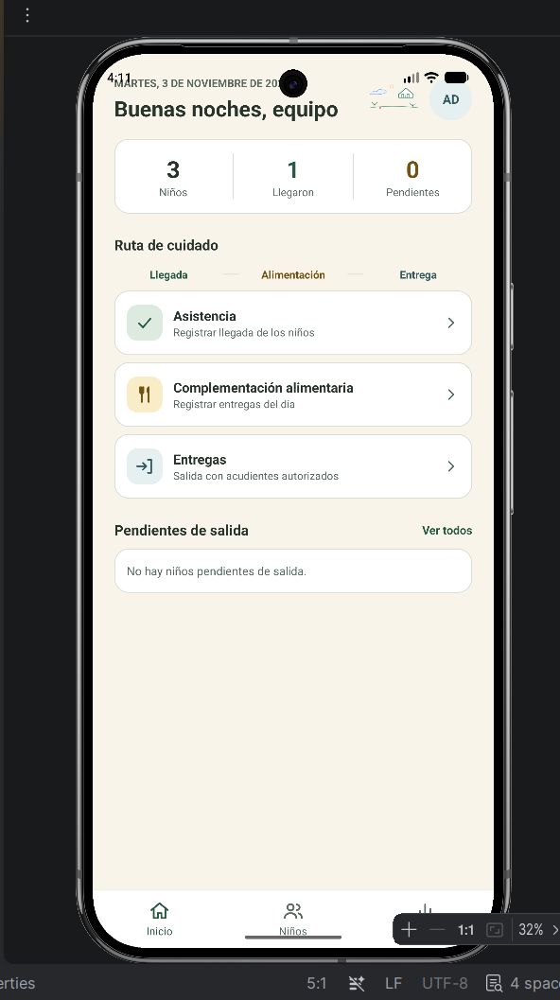
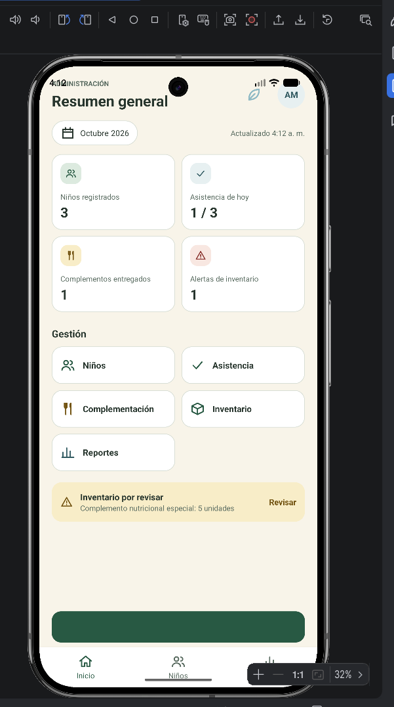
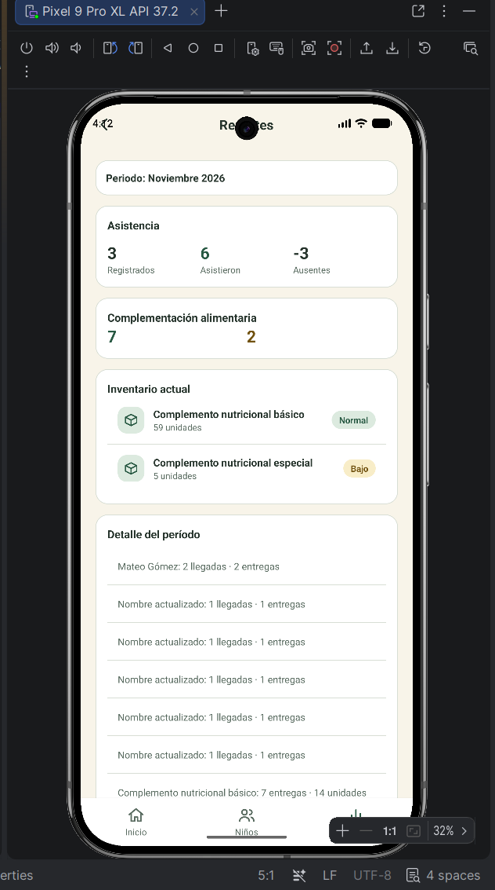

# Jardín Infantil — Aplicación Android

App móvil para acompañar asistencia, entregas a acudientes, alimentación, inventario y reportes. Usa Kotlin, vistas XML y Material 3.

## Pantallas

| Pantalla | Diseño |
|---|---|
| Acceso | `pantalla_acceso.xml` |
| Inicio | `pantalla_inicio.xml` |
| Niños y perfil | `pantalla_ninos.xml`, `pantalla_perfil_nino.xml` |
| Llegada y entrega | `pantalla_llegada.xml`, `pantalla_entrega.xml` |
| Alimentación | `pantalla_alimentacion.xml`, `pantalla_nueva_entrega.xml` |
| Administración e inventario | `pantalla_administracion.xml`, `pantalla_inventario.xml` |
| Reportes e historial | `pantalla_reportes.xml`, `pantalla_historial.xml` |

## API

El backend Node.js/MongoDB se mantiene en un repositorio separado. Clónalo por separado y sigue su README para iniciarlo; Android lo consume por HTTP y no incluye un servidor duplicado.

La app de emulador usa `http://10.0.2.2:3000/api`. Para cambiar la dirección, agrega `API_BASE_URL` a `gradle.properties` o ejecuta Gradle con `-PAPI_BASE_URL=http://IP:3000/api`. En un teléfono usa la IP local del equipo que ejecuta la API. En producción configura HTTPS.

## Acceso de desarrollo

Las cuentas de demostración las crea el comando de carga inicial del backend. Configura sus credenciales en el archivo local `.env` del backend y no publiques ese archivo ni contraseñas reales. En producción desactiva las cuentas de demostración y usa HTTPS. Las sesiones usan token y los permisos también se verifican en el servidor.

## Código principal

- `app/src/main/java/com/jardininfantil/app/ActividadPrincipal.kt`: navegación y acciones de Android.
- `app/src/main/java/com/jardininfantil/app/data/ApiJardin.kt`: cliente y conversión de la API.
- `app/src/main/java/com/jardininfantil/app/data/Modelos.kt`: modelos y sesión.
- `app/src/main/res/values/colores.xml` y `estilos.xml`: identidad visual.

Guía de ejecución y contratos: [GUIA_ANDROID_API.md](GUIA_ANDROID_API.md).

Reemplaza `JARDIN-XX` por la clave real de la tarea antes del commit. Revisa `git status` para confirmar que `local.properties`, `.idea`, `.gradle`, `build` y archivos `.env` no aparezcan.

## Evidencias del Sprint 1

Estas capturas fueron recibidas y guardadas en `evidencias/sprint_1/`. Muestran pantallas reales con la sesión iniciada. El reporte mensual es evidencia complementaria, pero no reemplaza el historial por fecha de HU-10.

| Archivo | Evidencia |
|---|---|
| `inicio_jornada.png` | Inicio de jornada y accesos a llegada, alimentación y entrega. |
| `resumen_administracion.png` | Resumen de administración, asistencia, inventario y alertas. |
| `reporte_mensual.png` | Reporte mensual de asistencia, complementación e inventario. |

### Inicio de jornada

### Resumen de administración

### Reporte mensual

**Revisión pendiente:** en `reporte_mensual.png` el indicador muestra `-3 ausentes`; corregir ese cálculo antes de presentar el reporte como resultado correcto.

Aún falta evidencia visual específica de HU-03 (perfil del niño y acudientes) y HU-10 (historial por fecha, con registros y sin registros), además del formulario de agregar acudiente y la persistencia tras reiniciar la API.

